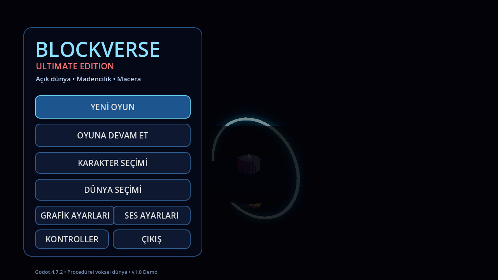
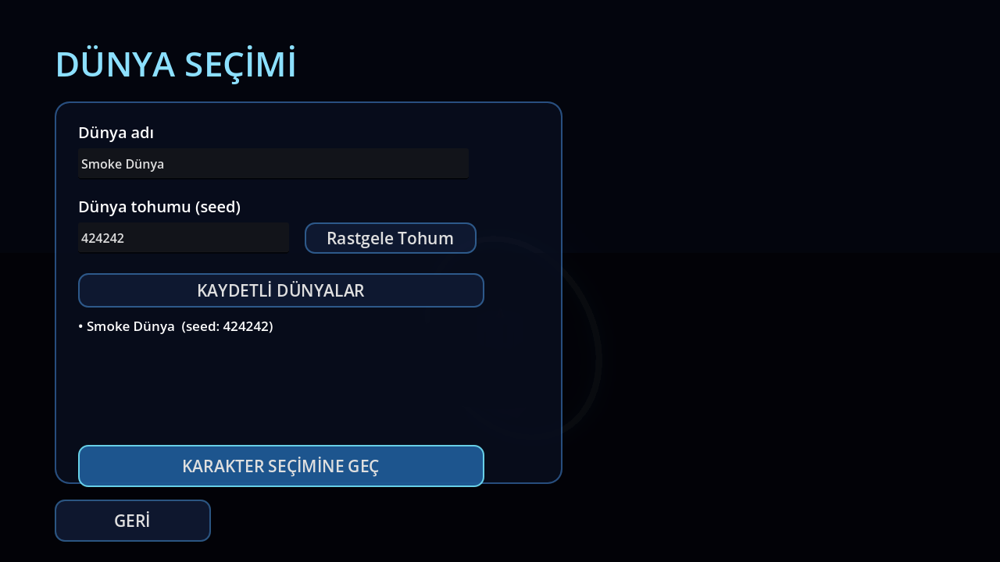
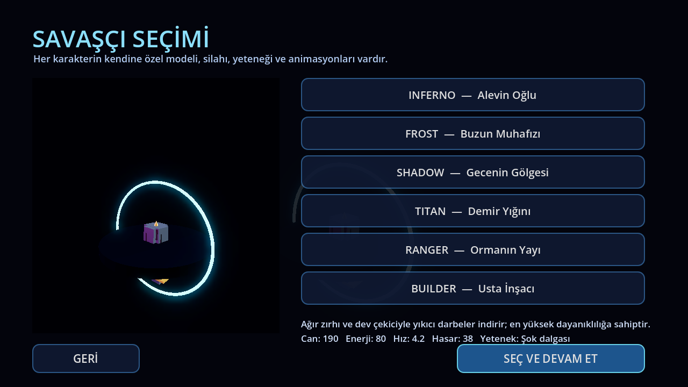
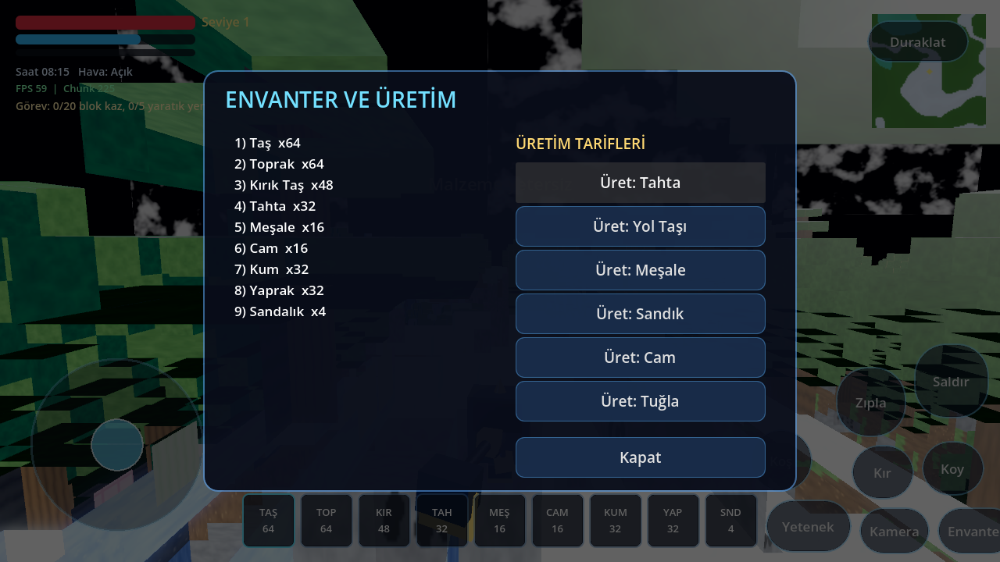

# BLOCKVERSE – Ultimate Edition

Prosedürel açık dünya voxel macera oyununun **oynanabilir Android Vertical Slice** demosu.
Gerçek Godot 4.7.2 3D projesidir; WebView/HTML/JavaScript prototipi değildir.

> Oyun çevrimdışıdır. Zorunlu internet, ücretli API veya abonelik yoktur.
> Telifli Minecraft/Roblox varlığı kullanılmaz; tüm görseller ve sesler çalışma zamanında prosedürel üretilir.

## Ekran görüntüleri

Bunlar çalışan oyundan alınmış gerçek görüntülerdir (`tests/capture.tscn`):

| Ana menü | Dünya seçimi | Karakter seçimi | Oyun içi |
| --- | --- | --- | --- |
|  |  |  |  |

## Demo'da gerçekten çalışanlar

- **Dünya:** seed'li prosedürel üretim, 16×16 chunk, 256 blok yükseklik, 12 biyom tanımı,
  greedy meshing, arka plan chunk üretimi, dinamik gökyüzü/sis/yağmur/kar/fırtına.
- **Karakterler:** 6 özgün savaşçı; iskelet tabanlı prosedürel rig, 11 animasyon durumu,
  farklı can/enerji/hız/hasar ve yetenekler.
- **Oynanış:** 1./3. şahıs kamera, yuvarlak analog joystick ve çoklu dokunma,
  blok kırma/koyma, envanter ve üretim, yakın dövüş ve element saldırıları.
- **Düşmanlar:** zombi, iskelet savaşçı, kurt ve taş golem; AI, takip, saldırı, hasar ve drop.
- **Sistem:** kayıt/yükleme, Türkçe menüler, grafik/ses/kontrol ayarları, FPS sayacı, mini harita.

Eksikler ve planlananlar açıkça [`ROADMAP.md`](ROADMAP.md) içinde listelenmiştir.
Gerçek cihaz FPS ölçümü yapılmadığı için performans iddiası bulunmaz.

## Çalıştırma

Godot **4.7.2-stable** ile projeyi açın ve `scenes/main.tscn` sahnesini çalıştırın.
Mobile renderer kullanıldığı için masaüstünde Vulkan 1.3 destekli bir GPU gerekir.

Komut satırı doğrulama örnekleri:

```powershell
$g = 'C:\Users\esen\AppData\Local\Temp\opencode\godot\Godot_v4.7.2-stable_win64_console.exe'
$p = 'C:\Users\esen\Documents\Default Project'

# Tüm GDScript dosyalarını doğrula
& $g --headless --path $p --scene 'res://tests/validate.tscn'

# Gerçek oyun oturumu smoke testi (14 kontrol)
& $g --headless --path $p --scene 'res://tests/smoke_test.tscn'

# Ekran görüntülerini yeniden üret
& $g --path $p --scene 'res://tests/capture.tscn'
```

## Kontroller

| Mobil | Masaüstü | Eylem |
| --- | --- | --- |
| Sol analog joystick | `W A S D` | Hareket |
| Sağda kaydırarak bakış | Fare hareketi | Kamera |
| Zıpla | `Boşluk` | Zıplama |
| Saldır | `Sol tık` / `J` | Yakın dövüş |
| Kır / Envanter | `Sağ tık` / `K` | Blok kırma, envanter |
| Koyma | `E` | Seçili blok yerleştirme |
| Yetenek | `F` / `Q` | Karakter yeteneği |
| Sonraki yuva | `Tekerlek` / `1-9` | Hotbar seçimi |
| Menü | `Esc` | Duraklatma / envanter |

## APK derleme

[`.github/workflows/android-build.yml`](.github/workflows/android-build.yml) iş akışı her `main`
push'unda ve elle tetiklemede çalışır:

1. JDK 17, Android SDK ve Godot 4.7.2 kurulur.
2. Export şablonları geçici olarak indirilir.
3. Debug keystore yalnızca CI sırasında `keytool` ile oluşturulur (depoda gizli anahtar yoktur).
4. `BlockVerse-Ultimate-Demo.apk` ARM64 debug APK olarak derlenip artifact olarak yüklenir.

Yerel derleme için Godot export şablonları, JDK 17 ve Android SDK gerekir; ardından
`godot --headless --path . --export-debug "Android ARM64 (Debug)" "builds/BlockVerse-Ultimate-Demo.apk"`
komutu kullanılabilir.

## Proje yapısı

```text
scenes/main.tscn              Giriş sahnesi (akış scripts/core/main.gd içinde)
scripts/core/                 Ayarlar, kayıt, ses, dokular, menüler, oyun oturumu
scripts/world/                Blok üretimi, chunk mesh/collision, streaming, çevre
scripts/entities/             Oyuncu, düşmanlar, rig, mermiler
scripts/gameplay/             Envanter ve üretim
scripts/ui/                   HUD, mini harita, mobil kontroller
tests/                        Doğrulama, smoke test, gerçek ekran görüntüsü yakalama
```

## Lisans ve kaynaklar

Kaynak ağacında lisanslı harici varlık yoktur; ayrıntılar
[`THIRD_PARTY_LICENSES.md`](THIRD_PARTY_LICENSES.md) içindedir.
Sürüm notları: [`CHANGELOG.md`](CHANGELOG.md).
